# IT401 Project Template

A Flask project template with a clean separation of concerns: routes, services, and models
are kept in their own files/directories so the codebase stays organized as it grows.

## Project Structure

```
project/
├── app.py                 # App factory, entry point
├── config.py               # Environment-based configuration
├── routes/                  # View functions
├── requirements.txt
├── services/                # Business logic and external integrations
│   ├── api_service.py       # Generic outbound HTTP client
│   ├── search_service.py    # Search logic
│   └── ai_service.py        # AI/LLM integration
├── models/                  # Data models
├── templates/                # Jinja2 HTML templates
├── static/                   # CSS, JS, images
├── data/                      # Local data files
└── tests/                      # Test suite
```

## Prerequisites

- Python 3.10+
- Git

## Setup

1. Clone the repository:

   ```bash
   git clone <repository-url>
   cd project
   ```

2. Create and activate a virtual environment:

   ```bash
   python3 -m venv .venv

   # macOS / Linux
   source .venv/bin/activate

   # Windows (Command Prompt / PowerShell)
   .venv\Scripts\activate
   ```

3. Install dependencies:

   ```bash
   pip install -r requirements.txt
   ```

## Running the App

With the virtual environment activated:

```bash
python app.py
```

The app will be available at [http://127.0.0.1:5000](http://127.0.0.1:5000).

By default it runs in development mode. Set `FLASK_ENV=production` to use the production config.

## Configuration

Configuration lives in `config.py` and reads from environment variables:

| Variable            | Description                          |
|---------------------|---------------------------------------|
| `SECRET_KEY`         | Flask secret key                      |
| `API_KEY`             | Key for external API service          |
| `AI_SERVICE_API_KEY`   | Key for AI service integration        |
| `FLASK_ENV`             | `development` or `production`         |

## Testing

With the virtual environment activated:

```bash
python -m pytest tests/
```
READEME Documentation:
ThreatPulse
Daniel Rowland
IT401 - Web Intelligence Assignment A1

The Purpose of this Application is to server the Cyber Security Analysts by simplifying the threats they need to assess in one app. This addresses the problem of too much information when doing a cyber security job and simplyfying everything into one app.

I plan to make this a full app that pulls data in a simulated enviroment and simplifies that data. I hope to be able to pull simulated data and make it easier to read the information, as well as the assets page. Currently, we have a main page that shows the information, a intellegence page, where you can view JSON pulled data, and an about page, about ThreatPulse

This will eventually manage plenty of assets, information on intelligence from JSON pulled data, and other threat viewing such as critical alerts and active threats

Some major directories and files include: 
Flask entry point and configuration
Routes and services directories
JSON threat data store (intelligence.html)
Shared and page-specific templates
CSS styling (style.css)
Tests and dependencies (app.py, test_app.py)
Current Threat Pulse application purpose

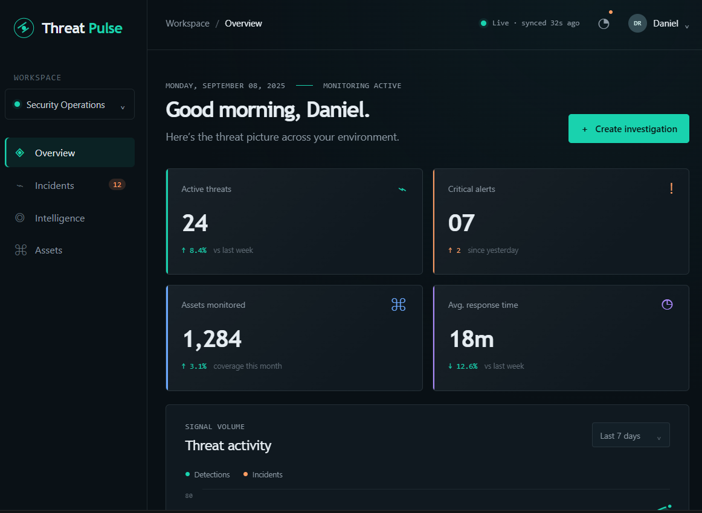
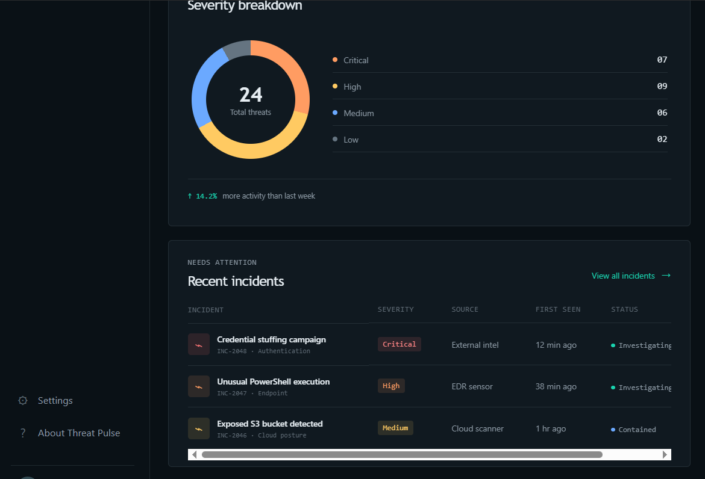
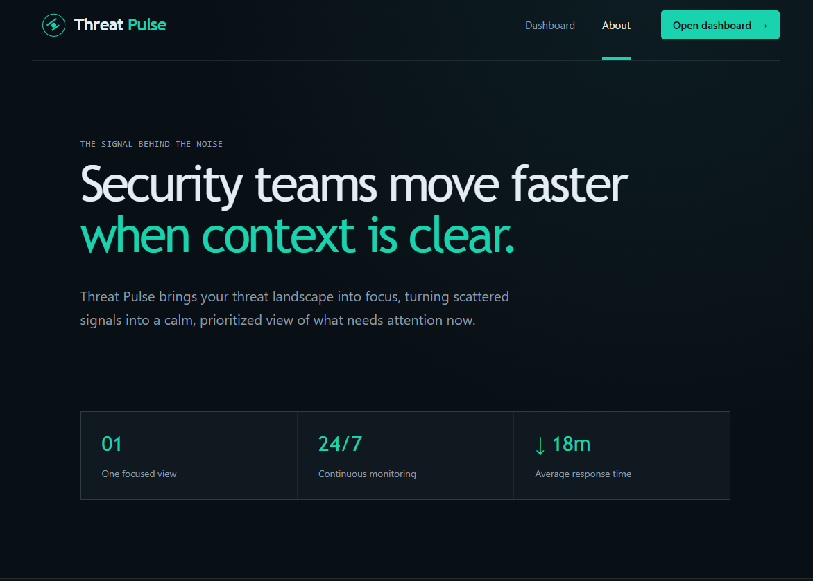
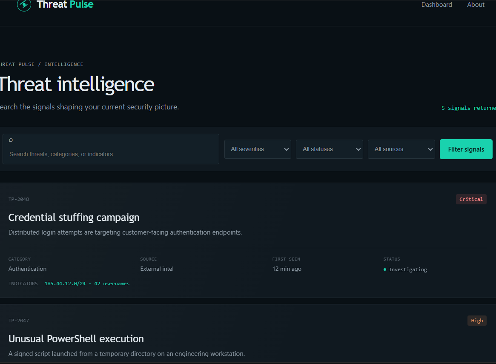
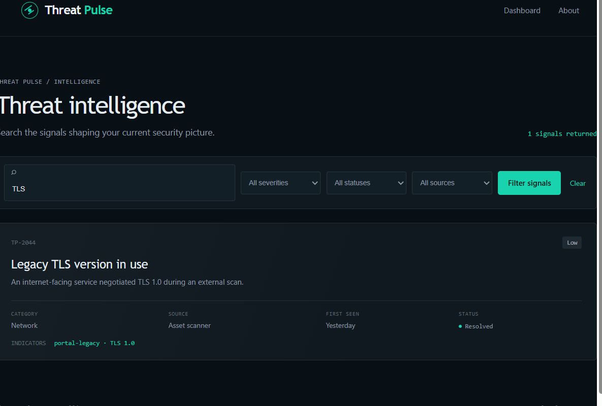

I plan to include multiple assets and include web pages for critical alerts and active threats, and many more.

ThreatPulse
Daniel Rowland
IT401 - Web Intelligence Assignment A2

(put readme information here)

## External Information Sources

### API service used

Threat Pulse uses the APIFreaks API for live domain infrastructure and WHOIS-style lookups.

### API endpoint(s)

The application sends requests to the APIFreaks domain lookup endpoint configured in `services/domain_lookup_service.py`. The endpoint receives a user-provided domain and returns infrastructure metadata such as registration, nameserver, DNS, and hosting-related information when available.

### Website(s) scraped

The application scrapes Bing HTML search results at `https://www.bing.com/search` for public threat-intelligence context. Search results are filtered for relevance before they are displayed.

### Purpose of each source

- APIFreaks provides live domain infrastructure intelligence for the domain lookup workflow.
- Bing provides public web context, source links, and summaries that supplement the local threat records.
- The local JSON store provides the primary set of Threat Pulse records used by the intelligence dashboard.

## Application Workflow

1. A user opens the dashboard or intelligence page.
2. `SearchService` loads threat records from `data/threats.json` and applies search, severity, status, and source filters.
3. `WebScraperService` searches Bing for each matching threat, extracts relevant HTML results, cleans the text, and calculates a risk score.
4. The Flask route combines local threat data with available external context and renders the result with Jinja templates.
5. For domain infrastructure lookup, the submitted domain is validated and sent to APIFreaks. The normalized response is rendered in the lookup page.

## Information Model

### Local information

Local threat records include:

- `id`
- `title`
- `severity`
- `category`
- `source`
- `status`
- `first_seen`
- `description`
- `indicators`

These records are stored in `data/threats.json` and form the primary intelligence feed.

### Externally acquired information

Scraped threat records may be enriched with:

- `web_summary`
- `web_reference`
- `reference_title`
- `web_risk_score`
- `web_risk_label`

Domain lookup responses are acquired from APIFreaks and contain normalized domain, registrar, nameserver, DNS, and infrastructure fields returned by that service. External fields are supplemental and do not replace the local threat record.

## Environment Variables

Create a `.env` file in the project root. Do not commit actual secrets.

```env
SECRET_KEY=replace-with-a-development-secret
APIFREAKS_API_KEY=replace-with-your-apifreaks-key
FLASK_ENV=development
```

The application supports `API_KEY` as a compatibility fallback, but `APIFREAKS_API_KEY` should be used for domain lookups.

## Installation Instructions

1. Create and activate a virtual environment:

   ```bash
   python -m venv .venv
   .venv\Scripts\activate
   ```

2. Install the required dependencies:

   ```bash
   pip install -r requirements.txt
   ```

3. Create `.env` in the project root and add the environment variables listed above.

4. Start the application:

   ```bash
   python app.py
   ```

5. Open [http://127.0.0.1:5000](http://127.0.0.1:5000).

Required dependencies include Flask, Requests, python-dotenv, and pytest for testing.

## Current Features

- APIFreaks API integration for live domain infrastructure lookup.
- Bing HTML web scraping for public threat-intelligence context.
- HTML decoding, tag removal, whitespace normalization, and result relevance filtering.
- Risk scoring based on local severity, indicators, and terms found in external context.
- User search and filtering by text, severity, status, and source.
- Concurrent scraper requests with preserved threat ordering.
- Error handling for missing credentials, failed requests, invalid inputs, and incomplete search results.

## Error Handling

- **Missing API key:** The domain lookup page displays a configuration message when `APIFREAKS_API_KEY` is not set.
- **API errors:** Request failures and invalid API responses are caught and displayed as user-facing lookup errors rather than crashing the application.
- **Invalid user input:** Domain validation rejects malformed or unsupported domain values before a lookup is attempted.
- **Missing HTML elements:** The scraper returns no enrichment when Bing results do not contain the expected result link or snippet. The local threat record remains available.
- **Unrelated search results:** Results without meaningful overlap with the threat title, category, or indicators are discarded.

## Ethical Considerations

- External results retain a source title and link for attribution.
- Requests use a short timeout and bounded concurrency to reduce load on the search provider.
- The scraper only reads publicly available search-result HTML and does not bypass access controls.
- API usage should follow APIFreaks terms, quotas, and rate limits.
- Scraped information should be treated as supporting intelligence and independently verified before taking action.

## Known Limitations

- Threat records are currently stored in a local JSON file rather than a persistent database.
- Bing HTML structure may change, which can require parser maintenance.
- Search availability and result quality depend on network access, provider responses, and query relevance.
- External context is not cached, so page loads may perform new searches.
- Risk scores are heuristic indicators and are not a substitute for analyst judgment.
- APIFreaks results depend on API availability, account limits, and the data returned for a domain.

## Future Work

The next development phase will replace the local JSON store with persistent storage. A database will store threat records, domain lookup results, scraped source metadata, risk scores, timestamps, and analyst review status. Future work will also include scheduled refresh jobs, deduplication, historical score tracking, user accounts, audit logging, and configurable retention policies. This will allow Threat Pulse to preserve intelligence between restarts, compare changes over time, and support multiple analysts working with the same data.

API Screenshots
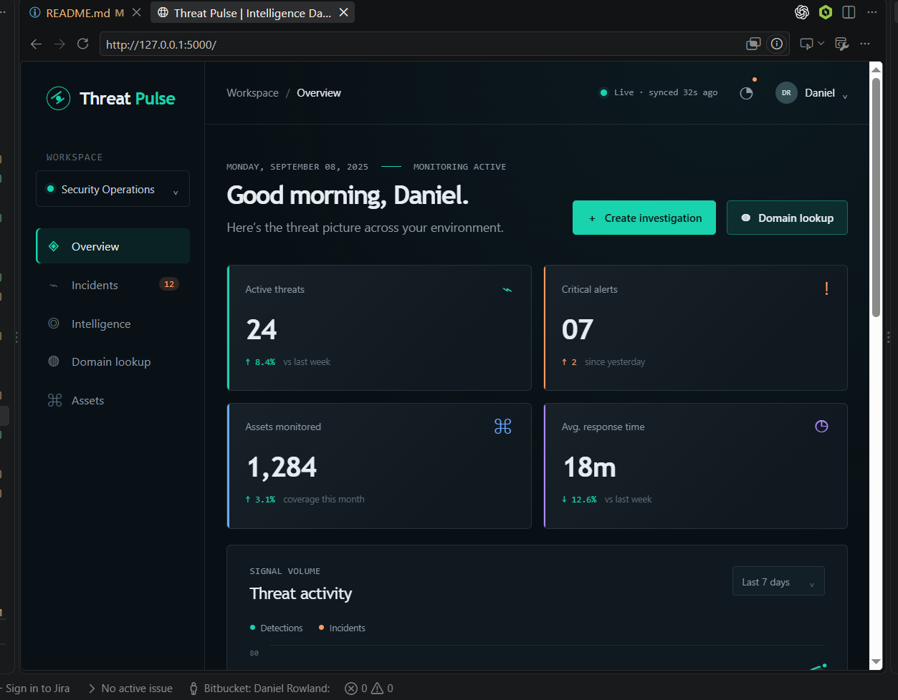
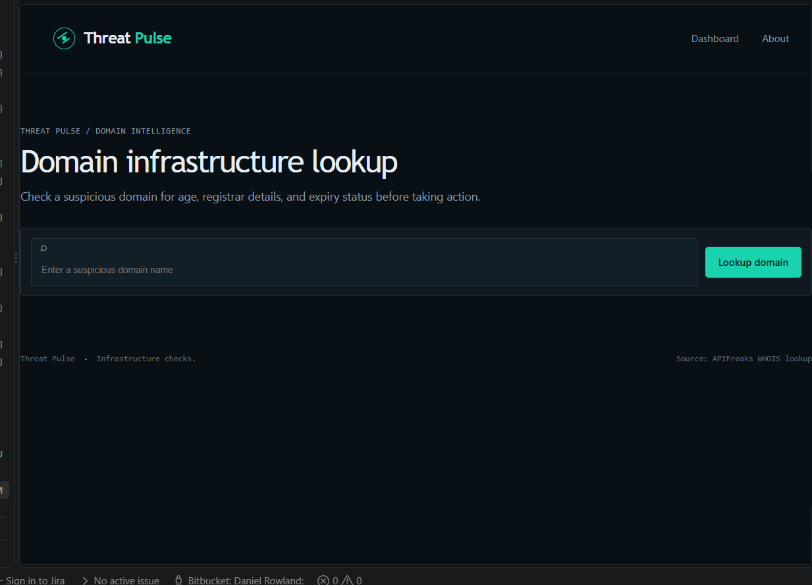
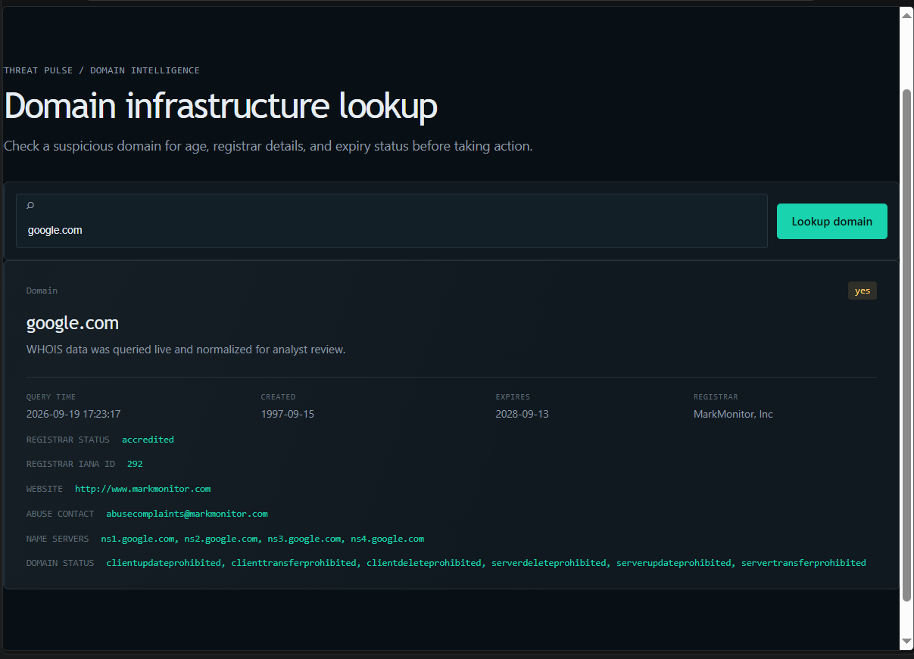
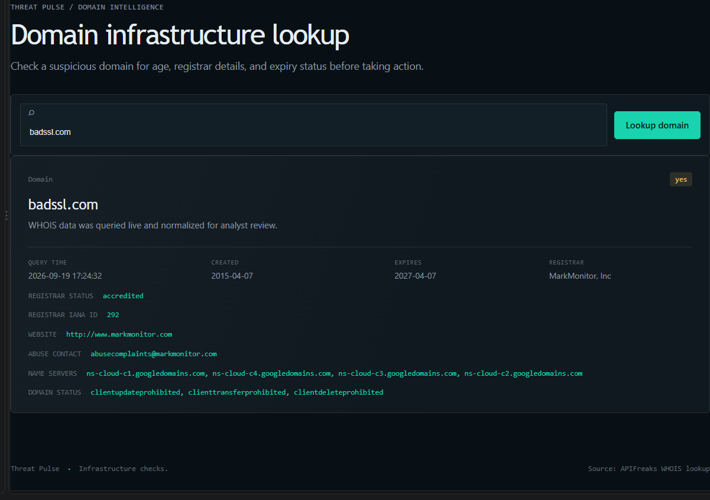
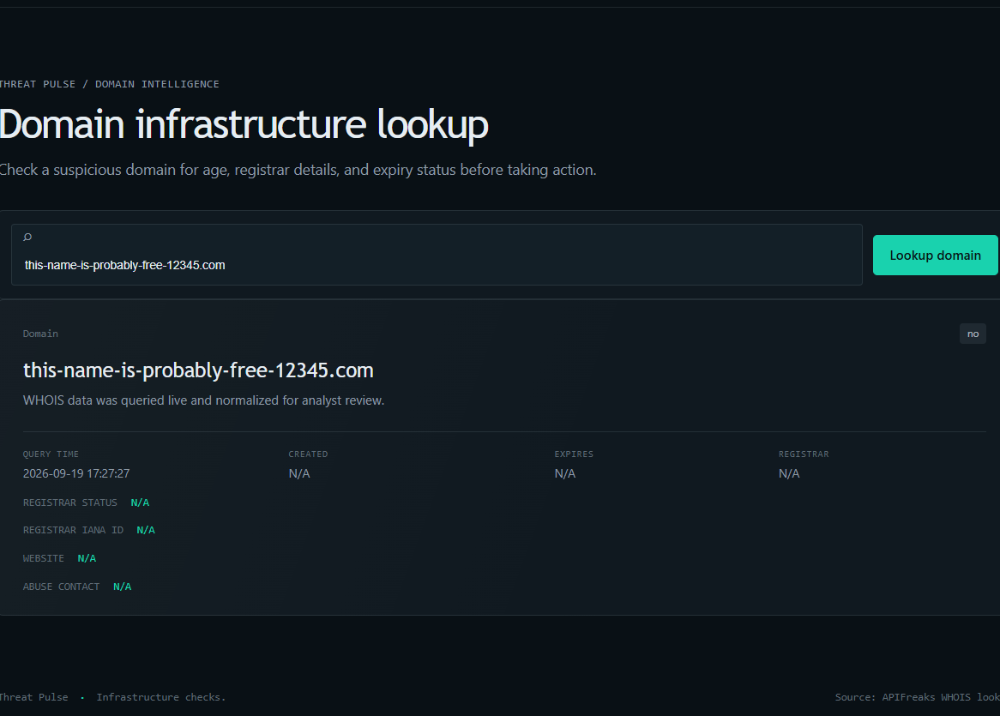

Web Scraping Images:
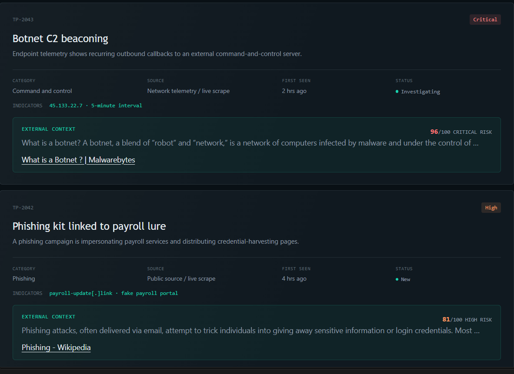


ThreatPulse
Daniel Rowland
IT401 - Web Intelligence Assignment A3

## Project Overview

Threat Pulse is a Flask cybersecurity intelligence application for security analysts. It combines a dashboard, threat records, public web context, domain lookups, and an asset inventory in one workspace.

## Information Persistence

- Asset records are stored in the Aiven MySQL `assets` table so inventory changes persist between requests and application restarts.
- Threat records are stored locally in `data/threats.json`.
- APIFreaks lookup responses and Bing search enrichment are fetched for a request and are not persisted.
- Search terms and filters are request parameters and are not persisted.

## Database Schema

The app uses `mysql-connector-python` directly; it does not use SQLAlchemy. `AssetService` creates the `assets` table with `CREATE TABLE IF NOT EXISTS` when the Assets page first connects. The MySQL user needs table-creation and CRUD permissions.

| Column | Type | Description |
| --- | --- | --- |
| `id` | `BIGINT UNSIGNED` | Auto-incrementing primary key. |
| `name` | `VARCHAR(120)` | Required asset name. |
| `asset_type` | `VARCHAR(40)` | Server, Database, Endpoint, Network, or Storage. |
| `owner` | `VARCHAR(120)` | Optional owner or team. |
| `environment` | `VARCHAR(80)` | Required environment. |
| `address` | `VARCHAR(255)` | Optional network address. |
| `status` | `VARCHAR(32)` | Active, Maintenance, or Offline; defaults to Active. |
| `risk` | `VARCHAR(32)` | Critical, High, Medium, or Low; defaults to Low. |
| `created_at` | `TIMESTAMP` | Row creation time. |
| `updated_at` | `TIMESTAMP` | Creation and last-update time. |

Indexes support searches by name and asset type. Asset names are not unique, so duplicate names are currently allowed; the row ID is the unique key.

## Application Architecture

The browser sends requests to Flask routes in `routes/main.py`. Those routes render Jinja templates or call services: `AssetService` talks to Aiven MySQL, `SearchService` reads the JSON threat feed, `WebScraperService` retrieves temporary Bing context, and `DomainLookupService` calls APIFreaks. `config.py` loads settings from environment variables, and `static/style.css` styles the pages. MySQL access uses the Connector/Python driver, not an ORM.

## Information Flow

1. A user opens the dashboard, Assets, intelligence, or domain lookup page.
2. The Assets route passes search and filter criteria to `AssetService`, which ensures the table exists and reads matching MySQL rows.
3. Create and update forms are validated server-side, then written with parameterized SQL. Delete actions use the asset's ID. Changes are committed and the page displays a result message.
4. The intelligence route filters local JSON threat records and adds any available public web context to the response without changing the JSON file.
5. The domain lookup route sends the submitted domain to APIFreaks and renders the returned details without saving them.

## Current Features

- Dashboard with threat summaries and recent incidents.
- APIFreaks domain infrastructure and WHOIS-style lookup.
- Bing HTML search for supplemental threat context and heuristic risk scoring.
- MySQL-backed asset inventory with create, read, update, and delete operations.
- Asset search by name, owner, environment, or address, with type and status filters.
- Threat search and filtering by text, severity, status, and source.
- Asset input validation and parameterized database queries.

## Project Structure

- `app.py`, `config.py`: Flask application factory and environment-based configuration.
- `routes/main.py`: Web routes and request handling.
- `services/`: MySQL asset CRUD, threat search, APIFreaks, scraping, and supporting integrations.
- `data/threats.json`: Local persistent threat records.
- `templates/`, `static/`: Jinja pages and shared CSS.
- `models/`: Model package.
- `tests/test_app.py`: Application and service tests.
- `requirements.txt`: Python dependencies.
- `.env.example`: Environment-variable template; keep real values in the ignored local `.env` file.

## Installation Instructions

1. Clone the course repository. **[Add the repository URL here; it is not available in this workspace.]**

   ```bash
   git clone <YOUR_REPOSITORY_URL>
   cd drowland-it401-final-project
   ```

2. Create and activate a virtual environment:

   ```powershell
   python -m venv .venv
   .venv\Scripts\Activate.ps1
   ```

   On macOS or Linux, use `source .venv/bin/activate`.

3. Install dependencies:

   ```bash
   python -m pip install -r requirements.txt
   ```

4. Create `.env` in the project root and set the variables listed below. Do not commit the file or include credentials in this README.
5. Ensure the Aiven database named by `MYSQL_DATABASE` exists and the configured user can create tables and perform CRUD operations. No manual table creation or seed data is required; the app creates an empty `assets` table on the first Assets request.
6. Run `python app.py`, then open [http://127.0.0.1:5000](http://127.0.0.1:5000). The Assets page is at `/assets`.

Run tests with `python -m pytest -q`.

## Environment Variables

Do not enter actual secrets in this README.

| Variable | Required | Purpose |
| --- | --- | --- |
| `MYSQL_HOST` | Yes for Assets | Aiven MySQL hostname. |
| `MYSQL_PORT` | No | MySQL port; defaults to `3306`. |
| `MYSQL_DATABASE` | Yes for Assets | Database name inside the Aiven service. |
| `MYSQL_USER` | Yes for Assets | Aiven database username. |
| `MYSQL_PASSWORD` | Yes for Assets | Aiven database password. |
| `MYSQL_SSL_CA` | No | Optional local path to a CA certificate; when set, certificate and host identity checks are enabled. |
| `APIFREAKS_API_KEY` | For domain lookup | APIFreaks API key; `API_KEY` is supported as a fallback. |
| `SECRET_KEY` | Recommended | Flask session signing key. |
| `FLASK_ENV` | No | `development` or `production`; defaults to development configuration. |
| `AI_SERVICE_API_KEY` | No | Optional AI-service setting; not required by current page workflows. |

## Error Handling

- Missing MySQL settings or connection failures are shown as user-facing messages; detailed database exceptions are logged server-side.
- Invalid asset fields are rejected and reported through form feedback. Missing asset IDs produce a not-found message.
- A missing APIFreaks key or failed API request is reported on the domain lookup page.
- Bing network failures or irrelevant search results produce no enrichment; local threat records remain available.

## Screenshots

The README includes screenshots of the homepage, the Aiven service view, and Assets-page CRUD states, including example rows shown in an earlier interface capture. The live asset table is empty after the CRUD test.

## Design Decisions

- Assets are persisted because inventory should survive application requests and restarts; threats remain in JSON for the current scope.
- A single `assets` table is sufficient for the current inventory workflow. Optional owner and address fields are nullable, while type, status, and risk values are validated by the application.
- `AssetService` isolates database work from route handlers. SQL parameters are bound separately from query text.
- Duplicate names are allowed; the auto-incrementing ID uniquely identifies each asset. No deduplication policy is implemented.

## Known Limitations

- Only assets use MySQL. Threats remain in a local JSON file; domain and scraped lookup results are temporary.
- Asset names may be duplicated. The inventory has no pagination or bulk editing.
- The app has no user authentication, authorization, or audit log and is not ready to be exposed as a production service.


## Future Work: A4 Search & Information Retrieval

 Proposed work is to expand search across asset and threat information, add sorting and pagination for larger result sets, and evaluate MySQL full-text search if it matches the assignment requirements. Search and filter behavior should be covered by tests for combined filters, empty results, and database errors.

mySQL Screenshots on the Assets.html page. CRUD demonstrated
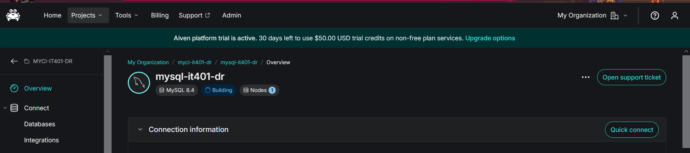
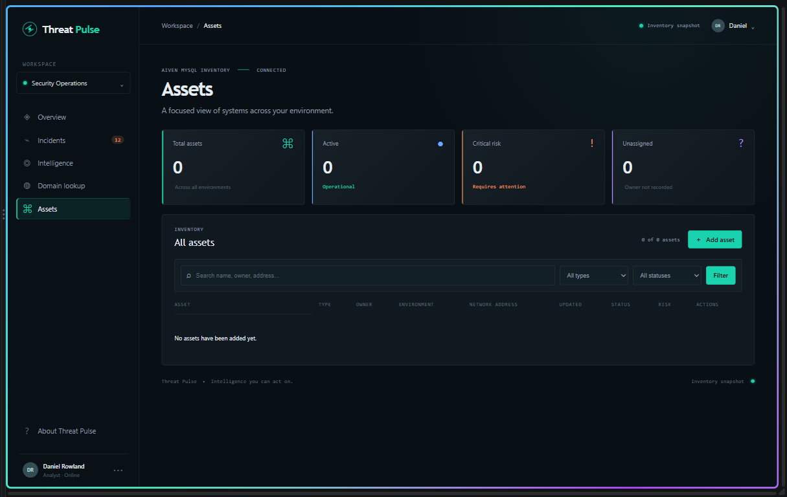
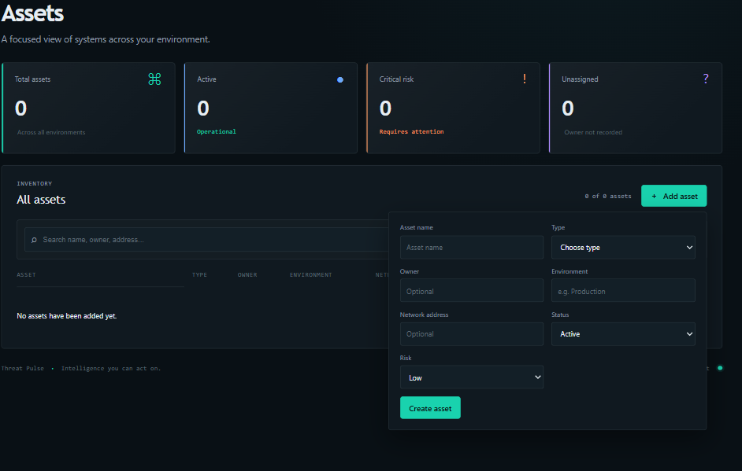
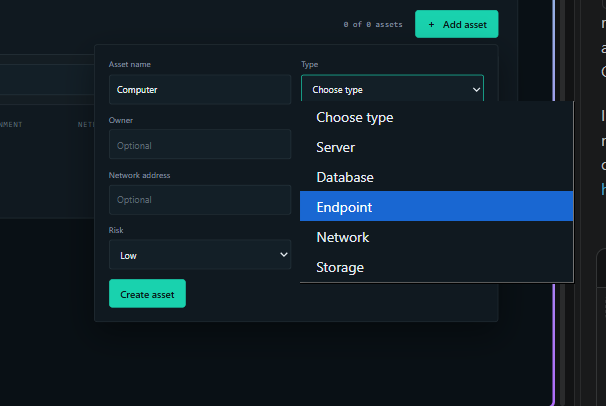
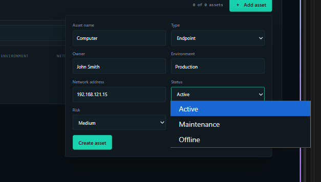
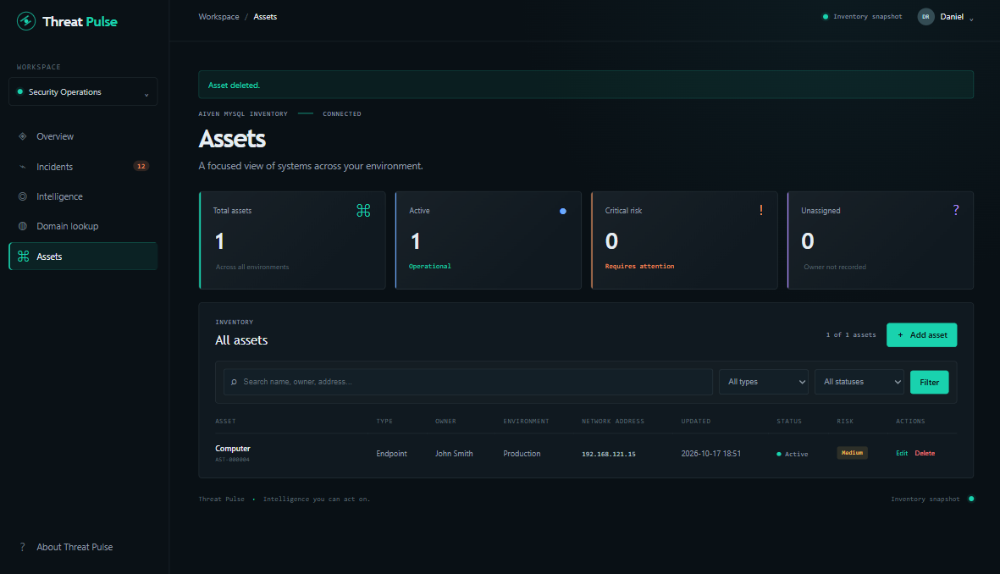
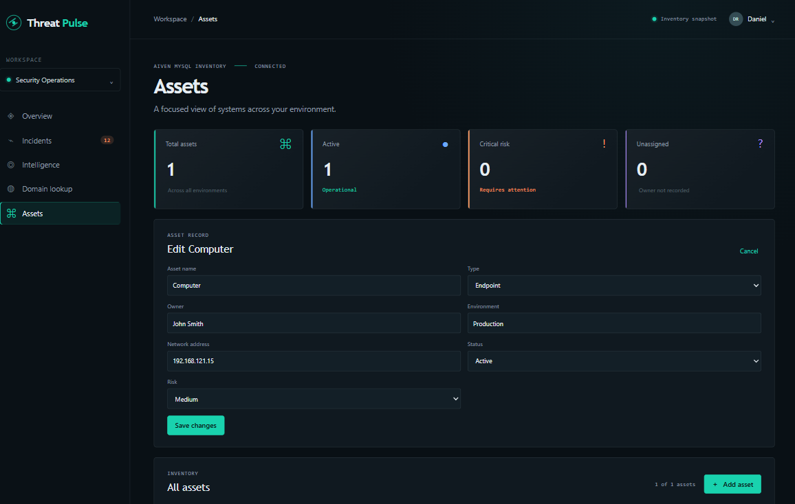
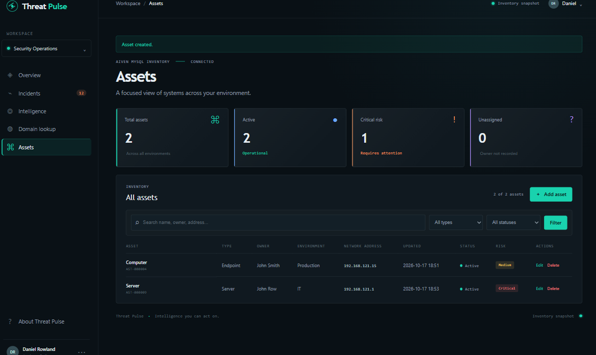
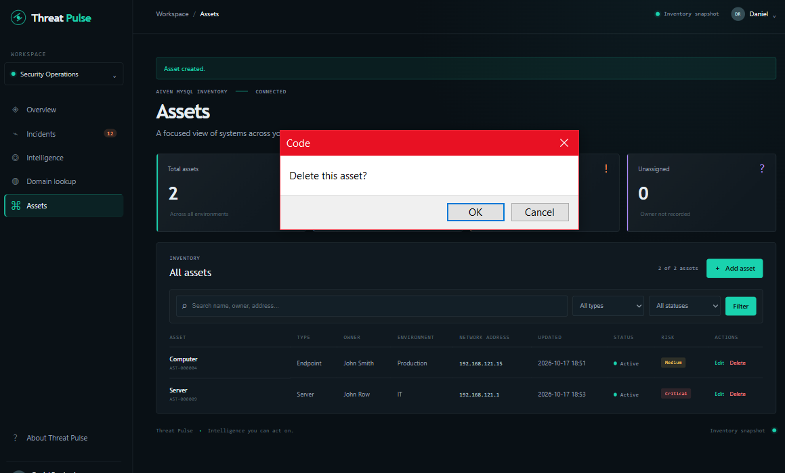
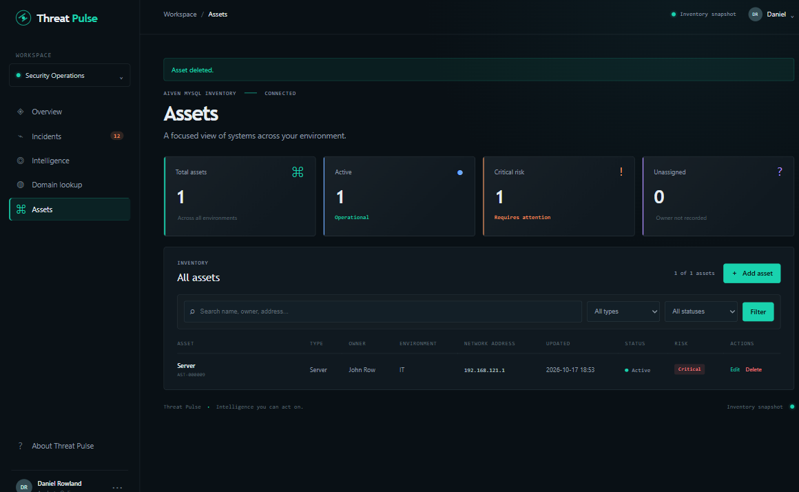