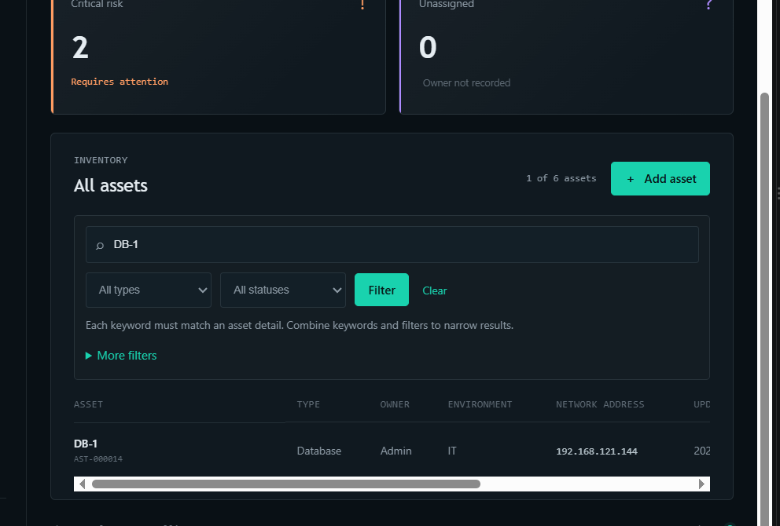
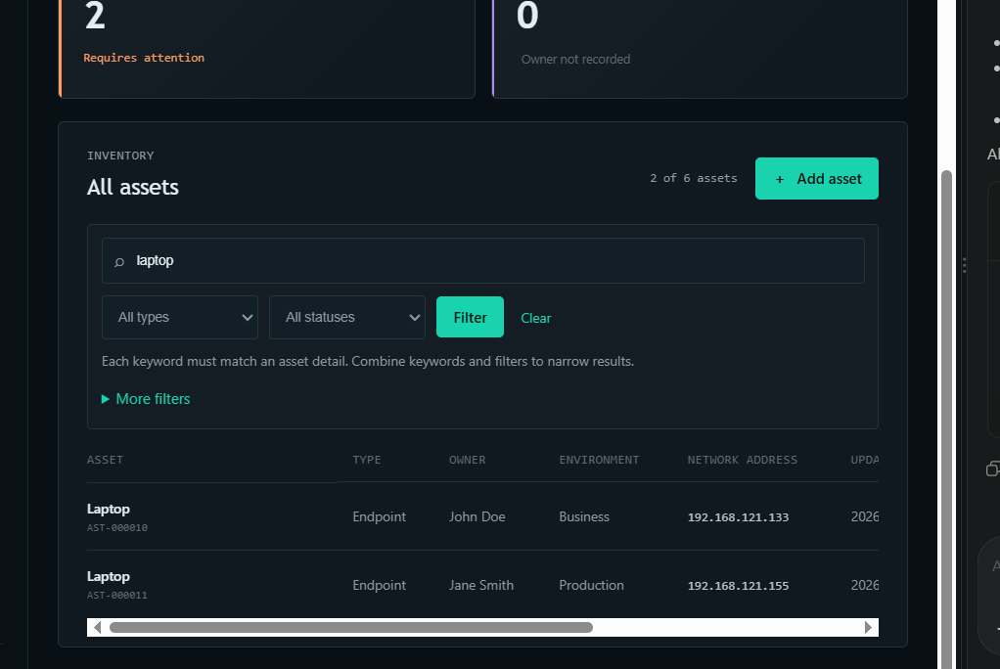
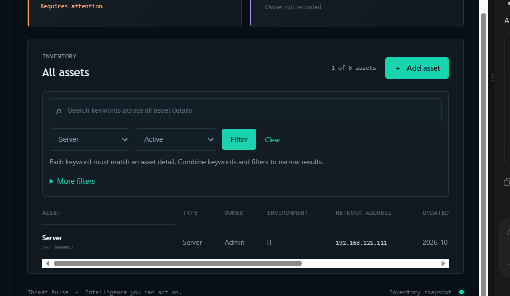
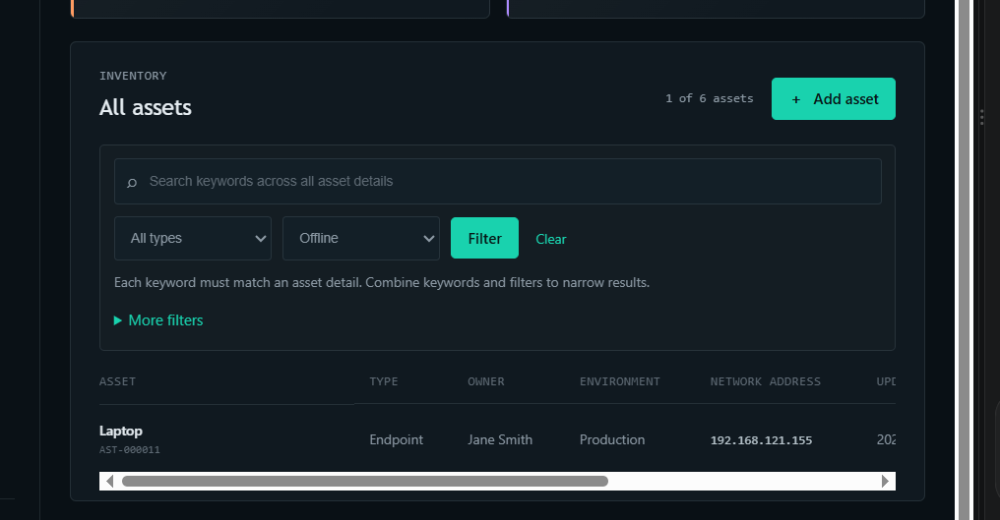
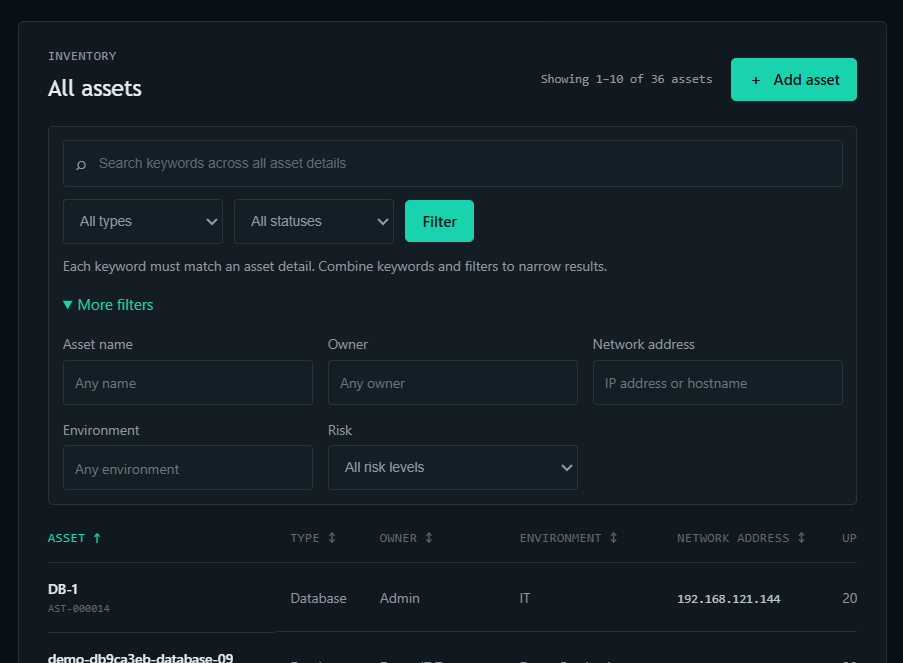
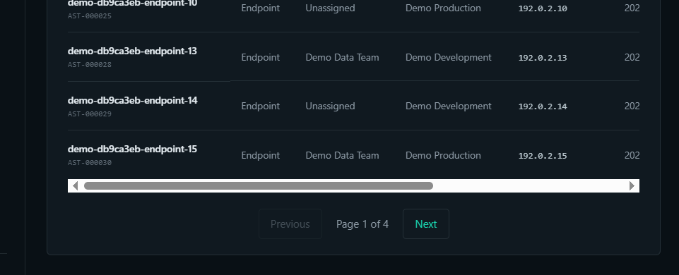
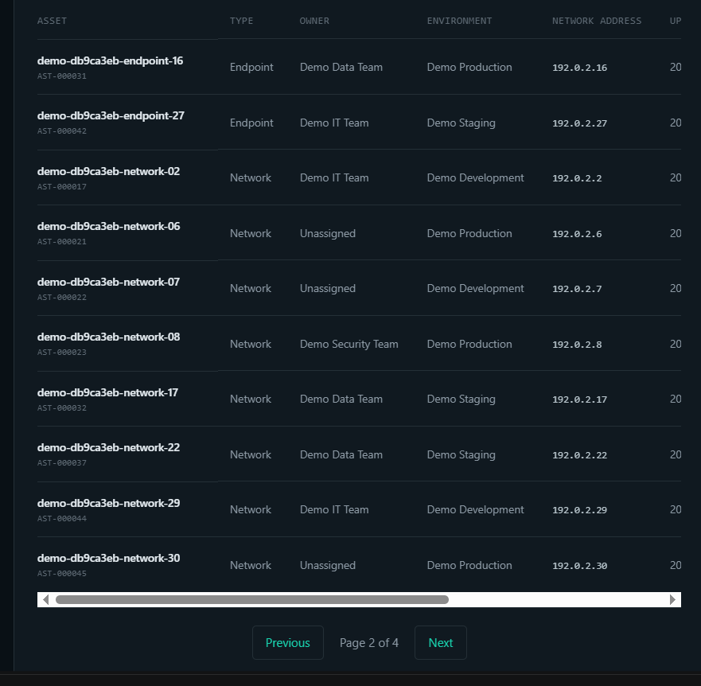
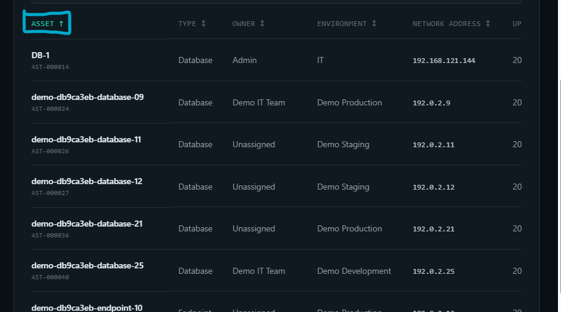
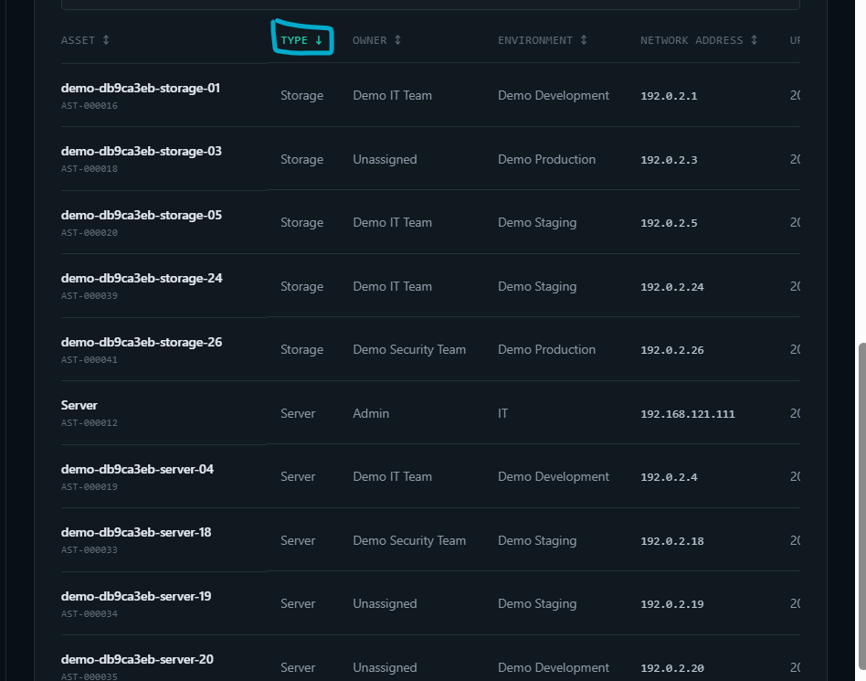
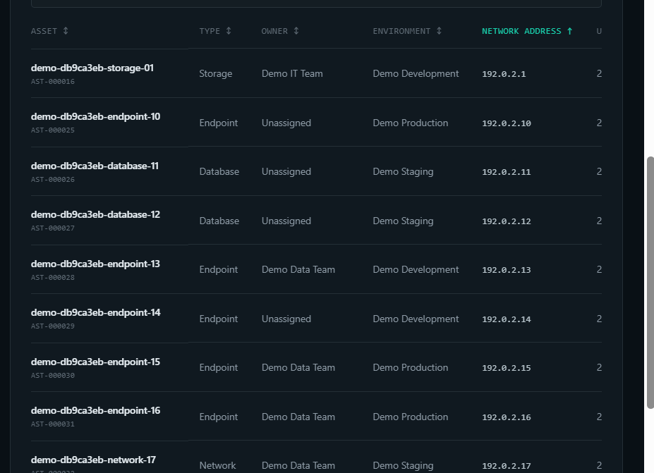

# IT401 Project Template

A Flask project template with a clean separation of concerns: routes, services, and models
are kept in their own files/directories so the codebase stays organized as it grows.

## Project Structure

```
project/
├── app.py                 # App factory, entry point
├── config.py               # Environment-based configuration
├── routes/                  # View functions
├── requirements.txt
├── services/                # Business logic and external integrations
│   ├── api_service.py       # Generic outbound HTTP client
│   ├── search_service.py    # Search logic
│   └── ai_service.py        # AI/LLM integration
├── models/                  # Data models
├── templates/                # Jinja2 HTML templates
├── static/                   # CSS, JS, images
├── data/                      # Local data files
└── tests/                      # Test suite
```

## Prerequisites

- Python 3.10+
- Git

## Setup

1. Clone the repository:

   ```bash
   git clone <repository-url>
   cd project
   ```

2. Create and activate a virtual environment:

   ```bash
   python3 -m venv .venv

   # macOS / Linux
   source .venv/bin/activate

   # Windows (Command Prompt / PowerShell)
   .venv\Scripts\activate
   ```

3. Install dependencies:

   ```bash
   pip install -r requirements.txt
   ```

## Running the App

With the virtual environment activated:

```bash
python app.py
```

The app will be available at [http://127.0.0.1:5000](http://127.0.0.1:5000).

By default it runs in development mode. Set `FLASK_ENV=production` to use the production config.

## Configuration

Configuration lives in `config.py` and reads from environment variables:

| Variable            | Description                          |
|---------------------|---------------------------------------|
| `SECRET_KEY`         | Flask secret key                      |
| `API_KEY`             | Key for external API service          |
| `AI_SERVICE_API_KEY`   | Key for AI service integration        |
| `FLASK_ENV`             | `development` or `production`         |

## Testing

With the virtual environment activated:

```bash
python -m pytest tests/
```
READEME Documentation:
ThreatPulse
Daniel Rowland
IT401 - Web Intelligence Assignment A1

The Purpose of this Application is to server the Cyber Security Analysts by simplifying the threats they need to assess in one app. This addresses the problem of too much information when doing a cyber security job and simplyfying everything into one app.

I plan to make this a full app that pulls data in a simulated enviroment and simplifies that data. I hope to be able to pull simulated data and make it easier to read the information, as well as the assets page. Currently, we have a main page that shows the information, a intellegence page, where you can view JSON pulled data, and an about page, about ThreatPulse

This will eventually manage plenty of assets, information on intelligence from JSON pulled data, and other threat viewing such as critical alerts and active threats

Some major directories and files include: 
Flask entry point and configuration
Routes and services directories
JSON threat data store (intelligence.html)
Shared and page-specific templates
CSS styling (style.css)
Tests and dependencies (app.py, test_app.py)
Current Threat Pulse application purpose


I plan to include multiple assets and include web pages for critical alerts and active threats, and many more.

~~~~~~~~~~~~~~~~~~~~~~~~~~~~~~~~~~~~~~~~~~~~~~~~~~~~~~~~~~~~~~~~~~~~~~~~~~~~~~~~~~~~~~~~~~~~~~~~~~~~~~~

ThreatPulse
Daniel Rowland
IT401 - Web Intelligence Assignment A2

(put readme information here)

## External Information Sources

### API service used

Threat Pulse uses the APIFreaks API for live domain infrastructure and WHOIS-style lookups.

### API endpoint(s)

The application sends requests to the APIFreaks domain lookup endpoint configured in `services/domain_lookup_service.py`. The endpoint receives a user-provided domain and returns infrastructure metadata such as registration, nameserver, DNS, and hosting-related information when available.

### Website(s) scraped

The application scrapes Bing HTML search results at `https://www.bing.com/search` for public threat-intelligence context. Search results are filtered for relevance before they are displayed.

### Purpose of each source

- APIFreaks provides live domain infrastructure intelligence for the domain lookup workflow.
- Bing provides public web context, source links, and summaries that supplement the local threat records.
- The local JSON store provides the primary set of Threat Pulse records used by the intelligence dashboard.

## Application Workflow

1. A user opens the dashboard or intelligence page.
2. `SearchService` loads threat records from `data/threats.json` and applies search, severity, status, and source filters.
3. `WebScraperService` searches Bing for each matching threat, extracts relevant HTML results, cleans the text, and calculates a risk score.
4. The Flask route combines local threat data with available external context and renders the result with Jinja templates.
5. For domain infrastructure lookup, the submitted domain is validated and sent to APIFreaks. The normalized response is rendered in the lookup page.

## Information Model

### Local information

Local threat records include:

- `id`
- `title`
- `severity`
- `category`
- `source`
- `status`
- `first_seen`
- `description`
- `indicators`

These records are stored in `data/threats.json` and form the primary intelligence feed.

### Externally acquired information

Scraped threat records may be enriched with:

- `web_summary`
- `web_reference`
- `reference_title`
- `web_risk_score`
- `web_risk_label`

Domain lookup responses are acquired from APIFreaks and contain normalized domain, registrar, nameserver, DNS, and infrastructure fields returned by that service. External fields are supplemental and do not replace the local threat record.

## Environment Variables

Create a `.env` file in the project root. Do not commit actual secrets.

```env
SECRET_KEY=replace-with-a-development-secret
APIFREAKS_API_KEY=replace-with-your-apifreaks-key
FLASK_ENV=development
```

The application supports `API_KEY` as a compatibility fallback, but `APIFREAKS_API_KEY` should be used for domain lookups.

## Installation Instructions

1. Create and activate a virtual environment:

   ```bash
   python -m venv .venv
   .venv\Scripts\activate
   ```

2. Install the required dependencies:

   ```bash
   pip install -r requirements.txt
   ```

3. Create `.env` in the project root and add the environment variables listed above.

4. Start the application:

   ```bash
   python app.py
   ```

5. Open [http://127.0.0.1:5000](http://127.0.0.1:5000).

Required dependencies include Flask, Requests, python-dotenv, and pytest for testing.

## Current Features

- APIFreaks API integration for live domain infrastructure lookup.
- Bing HTML web scraping for public threat-intelligence context.
- HTML decoding, tag removal, whitespace normalization, and result relevance filtering.
- Risk scoring based on local severity, indicators, and terms found in external context.
- User search and filtering by text, severity, status, and source.
- Concurrent scraper requests with preserved threat ordering.
- Error handling for missing credentials, failed requests, invalid inputs, and incomplete search results.

## Error Handling

- **Missing API key:** The domain lookup page displays a configuration message when `APIFREAKS_API_KEY` is not set.
- **API errors:** Request failures and invalid API responses are caught and displayed as user-facing lookup errors rather than crashing the application.
- **Invalid user input:** Domain validation rejects malformed or unsupported domain values before a lookup is attempted.
- **Missing HTML elements:** The scraper returns no enrichment when Bing results do not contain the expected result link or snippet. The local threat record remains available.
- **Unrelated search results:** Results without meaningful overlap with the threat title, category, or indicators are discarded.

## Ethical Considerations

- External results retain a source title and link for attribution.
- Requests use a short timeout and bounded concurrency to reduce load on the search provider.
- The scraper only reads publicly available search-result HTML and does not bypass access controls.
- API usage should follow APIFreaks terms, quotas, and rate limits.
- Scraped information should be treated as supporting intelligence and independently verified before taking action.

## Known Limitations

- Threat records are currently stored in a local JSON file rather than a persistent database.
- Bing HTML structure may change, which can require parser maintenance.
- Search availability and result quality depend on network access, provider responses, and query relevance.
- External context is not cached, so page loads may perform new searches.
- Risk scores are heuristic indicators and are not a substitute for analyst judgment.
- APIFreaks results depend on API availability, account limits, and the data returned for a domain.

## Future Work

The next development phase will replace the local JSON store with persistent storage. A database will store threat records, domain lookup results, scraped source metadata, risk scores, timestamps, and analyst review status. Future work will also include scheduled refresh jobs, deduplication, historical score tracking, user accounts, audit logging, and configurable retention policies. This will allow Threat Pulse to preserve intelligence between restarts, compare changes over time, and support multiple analysts working with the same data.

API Screenshots


Web Scraping Images:


~~~~~~~~~~~~~~~~~~~~~~~~~~~~~~~~~~~~~~~~~~~~~~~~~~~~~~~~~~~~~~~~~~~~~~~~~~~~~~~~~~~~~~~~~~~~~~~~~~~~~~~

ThreatPulse
Daniel Rowland
IT401 - Web Intelligence Assignment A3

## Project Overview

Threat Pulse is a Flask cybersecurity intelligence application for security analysts. It combines a dashboard, threat records, public web context, domain lookups, and an asset inventory in one workspace.

## Information Persistence

- Asset records are stored in the Aiven MySQL `assets` table so inventory changes persist between requests and application restarts.
- Threat records are stored locally in `data/threats.json`.
- APIFreaks lookup responses and Bing search enrichment are fetched for a request and are not persisted.
- Search terms and filters are request parameters and are not persisted.

## Database Schema

The app uses `mysql-connector-python` directly; it does not use SQLAlchemy. `AssetService` creates the `assets` table with `CREATE TABLE IF NOT EXISTS` when the Assets page first connects. The MySQL user needs table-creation and CRUD permissions.

| Column | Type | Description |
| --- | --- | --- |
| `id` | `BIGINT UNSIGNED` | Auto-incrementing primary key. |
| `name` | `VARCHAR(120)` | Required asset name. |
| `asset_type` | `VARCHAR(40)` | Server, Database, Endpoint, Network, or Storage. |
| `owner` | `VARCHAR(120)` | Optional owner or team. |
| `environment` | `VARCHAR(80)` | Required environment. |
| `address` | `VARCHAR(255)` | Optional network address. |
| `status` | `VARCHAR(32)` | Active, Maintenance, or Offline; defaults to Active. |
| `risk` | `VARCHAR(32)` | Critical, High, Medium, or Low; defaults to Low. |
| `created_at` | `TIMESTAMP` | Row creation time. |
| `updated_at` | `TIMESTAMP` | Creation and last-update time. |

Indexes support searches by name and asset type. Asset names are not unique, so duplicate names are currently allowed; the row ID is the unique key.

## Application Architecture

The browser sends requests to Flask routes in `routes/main.py`. Those routes render Jinja templates or call services: `AssetService` talks to Aiven MySQL, `SearchService` reads the JSON threat feed, `WebScraperService` retrieves temporary Bing context, and `DomainLookupService` calls APIFreaks. `config.py` loads settings from environment variables, and `static/style.css` styles the pages. MySQL access uses the Connector/Python driver, not an ORM.

## Information Flow

1. A user opens the dashboard, Assets, intelligence, or domain lookup page.
2. The Assets route passes search and filter criteria to `AssetService`, which ensures the table exists and reads matching MySQL rows.
3. Create and update forms are validated server-side, then written with parameterized SQL. Delete actions use the asset's ID. Changes are committed and the page displays a result message.
4. The intelligence route filters local JSON threat records and adds any available public web context to the response without changing the JSON file.
5. The domain lookup route sends the submitted domain to APIFreaks and renders the returned details without saving them.

## Current Features

- Dashboard with threat summaries and recent incidents.
- APIFreaks domain infrastructure and WHOIS-style lookup.
- Bing HTML search for supplemental threat context and heuristic risk scoring.
- MySQL-backed asset inventory with create, read, update, and delete operations.
- Asset search by name, owner, environment, or address, with type and status filters.
- Threat search and filtering by text, severity, status, and source.
- Asset input validation and parameterized database queries.

## Project Structure

- `app.py`, `config.py`: Flask application factory and environment-based configuration.
- `routes/main.py`: Web routes and request handling.
- `services/`: MySQL asset CRUD, threat search, APIFreaks, scraping, and supporting integrations.
- `data/threats.json`: Local persistent threat records.
- `templates/`, `static/`: Jinja pages and shared CSS.
- `models/`: Model package.
- `tests/test_app.py`: Application and service tests.
- `requirements.txt`: Python dependencies.
- `.env.example`: Environment-variable template; keep real values in the ignored local `.env` file.

## Installation Instructions

1. Clone the course repository. **[Add the repository URL here; it is not available in this workspace.]**

   ```bash
   git clone <YOUR_REPOSITORY_URL>
   cd drowland-it401-final-project
   ```

2. Create and activate a virtual environment:

   ```powershell
   python -m venv .venv
   .venv\Scripts\Activate.ps1
   ```

   On macOS or Linux, use `source .venv/bin/activate`.

3. Install dependencies:

   ```bash
   python -m pip install -r requirements.txt
   ```

4. Create `.env` in the project root and set the variables listed below. Do not commit the file or include credentials in this README.
5. Ensure the Aiven database named by `MYSQL_DATABASE` exists and the configured user can create tables and perform CRUD operations. No manual table creation or seed data is required; the app creates an empty `assets` table on the first Assets request.
6. Run `python app.py`, then open [http://127.0.0.1:5000](http://127.0.0.1:5000). The Assets page is at `/assets`.

Run tests with `python -m pytest -q`.

## Environment Variables

Do not enter actual secrets in this README.

| Variable | Required | Purpose |
| --- | --- | --- |
| `MYSQL_HOST` | Yes for Assets | Aiven MySQL hostname. |
| `MYSQL_PORT` | No | MySQL port; defaults to `3306`. |
| `MYSQL_DATABASE` | Yes for Assets | Database name inside the Aiven service. |
| `MYSQL_USER` | Yes for Assets | Aiven database username. |
| `MYSQL_PASSWORD` | Yes for Assets | Aiven database password. |
| `MYSQL_SSL_CA` | No | Optional local path to a CA certificate; when set, certificate and host identity checks are enabled. |
| `APIFREAKS_API_KEY` | For domain lookup | APIFreaks API key; `API_KEY` is supported as a fallback. |
| `SECRET_KEY` | Recommended | Flask session signing key. |
| `FLASK_ENV` | No | `development` or `production`; defaults to development configuration. |
| `AI_SERVICE_API_KEY` | No | Optional AI-service setting; not required by current page workflows. |

## Error Handling

- Missing MySQL settings or connection failures are shown as user-facing messages; detailed database exceptions are logged server-side.
- Invalid asset fields are rejected and reported through form feedback. Missing asset IDs produce a not-found message.
- A missing APIFreaks key or failed API request is reported on the domain lookup page.
- Bing network failures or irrelevant search results produce no enrichment; local threat records remain available.

## Screenshots

The README includes screenshots of the homepage, the Aiven service view, and Assets-page CRUD states, including example rows shown in an earlier interface capture. The live asset table is empty after the CRUD test.

## Design Decisions

- Assets are persisted because inventory should survive application requests and restarts; threats remain in JSON for the current scope.
- A single `assets` table is sufficient for the current inventory workflow. Optional owner and address fields are nullable, while type, status, and risk values are validated by the application.
- `AssetService` isolates database work from route handlers. SQL parameters are bound separately from query text.
- Duplicate names are allowed; the auto-incrementing ID uniquely identifies each asset. No deduplication policy is implemented.

## Known Limitations

- Only assets use MySQL. Threats remain in a local JSON file; domain and scraped lookup results are temporary.
- Asset names may be duplicated. The inventory has no pagination or bulk editing.
- The app has no user authentication, authorization, or audit log and is not ready to be exposed as a production service.


## Future Work: A4 Search & Information Retrieval

 Proposed work is to expand search across asset and threat information, add sorting and pagination for larger result sets, and evaluate MySQL full-text search if it matches the assignment requirements. Search and filter behavior should be covered by tests for combined filters, empty results, and database errors.

mySQL Screenshots on the Assets.html page. CRUD demonstrated


~~~~~~~~~~~~~~~~~~~~~~~~~~~~~~~~~~~~~~~~~~~~~~~~~~~~~~~~~~~~~~~~~~~~~~~~~~~~~~~~~~~~~~~~~~~~~~~~~~~~~~~

ThreatPulse
Daniel Rowland
IT401 - Web Intelligence Assignment A4

## Project Overview

ThreatPulse is a Flask web application that combines a searchable asset inventory, local threat intelligence, live domain lookups, and public web context. It helps cybersecurity analysts and IT administrators locate systems, review their recorded status and risk, and investigate threats from one workspace.

A4 expands the Assets page with keyword search, combined filters, clickable sorting, and database pagination. These features help users find specific systems without scanning the entire inventory. The Intelligence page separately searches local threat records; asset and threat searches are not combined.

This section describes the current A4 implementation. Earlier assignment sections describe earlier versions, including limitations that A4 has since addressed.

## Search and Retrieval Features

| Feature | Current behavior |
| --- | --- |
| Keyword search | Case-insensitive substring matching. Every whitespace-separated asset keyword must match at least one searchable field. |
| Fields searched | Asset name, type, owner, environment, network address, status, and risk. |
| Filters | Name, owner, address, and environment substring filters; type, status, and risk exact-value filters. All supplied filters are combined. |
| Sorting | Click Asset, Type, Owner, Environment, Network address, Status, or Risk for alphabetical sorting. Updated sorts by timestamp. Clicking the selected heading reverses direction. |
| Ranking method | No relevance score or relevance ranking is implemented for assets. Results use the selected column order, with ascending ID as a tie-breaker. |
| Pagination | Ten matching assets per page, with Previous/Next controls and a page count. Sorting and filters persist between pages. |
| Retrieval feedback | The page shows the displayed range and matching total, a no-results message, and a Clear link when filters are active. Summary cards describe the full inventory. |
| Search telemetry | Not implemented. Search-history storage, query analytics, click tracking, and relevance ratings are outstanding. |

## Search Workflow

```text
User enters keywords and/or filters on /assets
    -> Browser submits a GET request with search parameters
    -> Route trims filter values and checks sort/page parameters
    -> AssetService builds parameterized MySQL WHERE conditions
    -> MySQL counts all matching records
    -> Requested page is clamped to the available page range
    -> MySQL applies ORDER BY, LIMIT 10, and OFFSET
    -> Flask renders rows, matching count, sort arrows, and page controls
```

Changing a filter or sort starts at the first page. Page links preserve the active query, filters, sort column, and direction. Retrieval does not currently write a search-history record.

## Searchable Information

| Record/source | Searchable fields | Filters | Ranking |
| --- | --- | --- | --- |
| Assets: MySQL `assets` table | `name`, `asset_type`, `owner`, `environment`, `address`, `status`, `risk` | Name, owner, address, environment, type, status, risk | No relevance weighting; selected column sort and ID tie-breaker. |
| Threats: `data/threats.json` | `title`, `category`, `source`, `description` | Severity, status, source | Original JSON feed order is preserved. |

Asset fields cover the identifiers, ownership, location, and operational details analysts use to find systems. Specific text filters narrow searches to one field; categorical filters provide predictable choices. Asset IDs and timestamps are not keyword-search fields, although Updated is sortable. Missing owners display as Unassigned, but that display label is not stored as searchable owner text.

The `models/` directory currently contains only a package initializer. Assets are retrieved through `AssetService`, and threats through `SearchService`; there are no ORM model classes or unified search index. No asset field has an assigned relevance weight.

## Retrieval Strategy

Asset keyword matching uses MySQL `LOWER(COALESCE(column, '')) LIKE %s ESCAPE '!'`. Each keyword becomes a `%keyword%` substring pattern. Fields within one keyword condition are joined with OR; separate keyword conditions and all supplied filters are joined with AND. For example, `server production security` can match type, environment, and owner on the same asset.

Name, owner, address, and environment filters use the same substring strategy. Type, status, and risk use case-insensitive equality. SQL wildcard characters `%` and `_`, and the escape character `!`, are escaped so search input is treated literally. Values are bound separately from SQL text. Sort columns and directions are selected from allowed values before being placed in `ORDER BY`.

The default asset order is name A–Z, followed by ascending ID for ties. Text sorting is case-insensitive; missing owners sort using the displayed Unassigned label. Updated sorts chronologically. Risk sorts alphabetically rather than by severity, and network addresses sort as text rather than numerically by IP octet. Sorting occurs before pagination across the full matching result set.

Assets use `LIKE`, not `ILIKE`, MySQL full-text search, or semantic search. Threat search uses a case-insensitive Python substring check against concatenated fields; its complete query is matched as one string rather than split into independent keywords.

The scraper separately selects a Bing result using overlapping terms from the threat title, category, and indicators. Its heuristic risk score enriches threat cards but does not rank asset results or reorder the threat feed. Current retrieval lacks synonym expansion, stemming, and relevance weighting. Leading-wildcard substring searches may become expensive as the inventory grows.

## Search Telemetry

**Not implemented:** the application does not persist structured search events, result counts, durations, selected-result clicks, or user feedback. Search values appear in GET URLs, and development server access logs may contain those URLs; these logs are not a dedicated telemetry system.

A future implementation could record query text, filters, sort choice, result count, execution time, and timestamp. Aggregate analysis could identify common searches, zero-result queries, and slow retrieval paths, informing query suggestions, indexing, and later recommendations. Retention and handling of potentially sensitive search text would need to be defined before collection begins.

## Database Schema

The current application schema contains one table used by Assets. A4 adds retrieval behavior without adding tables or columns.

| Table | Purpose | Primary key | Relationships |
| --- | --- | --- | --- |
| `assets` | Persistent inventory for CRUD, search, filters, sorting, and pagination | `id`: auto-incrementing unsigned BIGINT | No foreign keys or relationships to other application tables. Threats remain in JSON. |

| Attribute | Definition/purpose |
| --- | --- |
| `name` | Required VARCHAR(120), searchable asset name. |
| `asset_type` | Required VARCHAR(40), searchable/filterable type; returned to templates as `type`. |
| `owner` | Nullable VARCHAR(120), responsible person/team. |
| `environment` | Required VARCHAR(80), deployment environment. |
| `address` | Nullable VARCHAR(255), network address or hostname. |
| `status` | Required VARCHAR(32), defaults to Active. |
| `risk` | Required VARCHAR(32), defaults to Low. |
| `created_at` | Timestamp populated when inserted. |
| `updated_at` | Timestamp updated automatically when the record changes. |

The table uses InnoDB and utf8mb4, with ordinary indexes on `name` and `asset_type`. It has no full-text index. `AssetService` runs `CREATE TABLE IF NOT EXISTS` when opening a database operation. This creates a missing table but does not migrate an incompatible existing schema.

**Search-history/telemetry schema: outstanding.** No such table, primary key, attributes, or relationships are implemented, so an implemented telemetry schema cannot be documented yet.

## Current Features Through A4

- Homepage and shared navigation for the ThreatPulse workspace.
- APIFreaks live domain WHOIS API integration, returning registrar, registration, expiry, and nameserver information.
- Bing HTML scraping with text cleanup, source attribution, relevance filtering, and heuristic threat-risk scoring.
- Local JSON threat keyword search with severity, status, and source filters.
- Aiven MySQL persistence for asset inventory and create, read, update, and delete operations using bound SQL parameters.
- Asset keyword search across seven fields, combined basic/advanced filters, and a Clear action.
- Clickable column sorting with ascending/descending indicators and ten-row pagination.
- Matching-result counts, displayed ranges, and no-results feedback.
- Asset data validation for required fields, length limits, and allowed type/status/risk values. Optional owner/address fields can be omitted; network-address syntax is not validated.
- A demo-data script that adds 30 clearly fictional assets with `demo-` names and documentation-range addresses. Each invocation adds another batch and preserves existing rows.
- Automated search, filtering, sorting, pagination, validation, and route tests.

Asset relevance ranking and structured search telemetry remain unimplemented. The scraper's risk scoring is separate from asset retrieval ranking.

## Project Structure

```text
drowland-it401-final-project/
|-- app.py                         # Flask app factory and development entry point
|-- config.py                      # Environment-based configuration
|-- requirements.txt               # Python dependencies
|-- .env.example                   # Environment template; no real credentials
|-- README.md                      # Setup and assignment documentation
|-- routes/
|   |-- __init__.py
|   `-- main.py                    # Pages, search parameters, CRUD handlers
|-- services/
|   |-- __init__.py
|   |-- asset_service.py           # MySQL schema, validation, CRUD, retrieval
|   |-- search_service.py          # Local JSON threat search
|   |-- domain_lookup_service.py   # APIFreaks integration
|   |-- web_scraper_service.py     # Bing parsing, relevance and risk scoring
|   |-- api_service.py             # Generic HTTP client helper
|   `-- ai_service.py              # AI integration scaffold
|-- models/
|   `-- __init__.py                # Model package placeholder
|-- data/
|   `-- threats.json               # Local threat records
|-- templates/
|   |-- base.html                  # Shared layout
|   |-- index.html                 # Homepage
|   |-- assets.html                # Inventory forms, search, table, page controls
|   |-- intelligence.html          # Threat intelligence results
|   |-- domain_lookup.html         # Domain lookup workflow
|   `-- about.html                 # Application background
|-- static/
|   `-- style.css                  # Shared and page-specific styling
|-- scripts/
|   `-- seed_demo_assets.py        # Optional fictional inventory generator
`-- tests/
    |-- __init__.py
    |-- test_app.py                # Route, filter, link, and integration-unit tests
    `-- test_asset_search.py       # SQL retrieval, sorting, and pagination tests
```

Screenshot PNG files are stored in the project root. There is currently no migrations directory or telemetry module.

## Installation Instructions

1. Clone the repository and enter the project directory:

   ```powershell
   git clone https://github.com/danielrowland578/drowland-it401-final-project.git
   cd drowland-it401-final-project
   ```

2. Create a virtual environment and install dependencies:

   ```powershell
   python -m venv .venv
   .\.venv\Scripts\python.exe -m pip install -r requirements.txt
   ```

3. Create a local `.env` using the variable names in the next section. Copy connection values from the existing Aiven MySQL service. Do not commit credentials. If using `.env.example`, put `MYSQL_SSL_CA=` on its own line and remove the accidentally attached comment from its value.

4. Ensure the configured database exists and the account can connect, create the `assets` table, and perform CRUD. No migration command exists in this repository. The first asset database operation creates the table if missing; changes to an existing table require a separate schema update.

5. Start the application:

   ```powershell
   .\.venv\Scripts\python.exe app.py
   ```

   Open [http://127.0.0.1:5000](http://127.0.0.1:5000) or go directly to `/assets`. The process must have network access to the Aiven host and configured port. During local verification, sandboxed execution caused Windows error 10013; running with the necessary network permission restored database access.

6. Optionally add a new batch of 30 fictional assets:

   ```powershell
   .\.venv\Scripts\python.exe scripts/seed_demo_assets.py
   ```

7. Run the test suite:

   ```powershell
   .\.venv\Scripts\python.exe -m pytest -q -p no:cacheprovider
   ```

## Environment Variables

Use the names read by `config.py`; generic `DB_*` and `RAPIDAPI_KEY` names are not used by this application.

| Variable | Requirement and purpose |
| --- | --- |
| `MYSQL_HOST` | Required for Assets: Aiven MySQL hostname. |
| `MYSQL_PORT` | MySQL port from the service connection settings; defaults to 3306. |
| `MYSQL_DATABASE` | Required for Assets: existing database name. |
| `MYSQL_USER` | Required for Assets: database username. |
| `MYSQL_PASSWORD` | Required for Assets: database password. |
| `MYSQL_SSL_CA` | Optional local certificate path; enables certificate and hostname verification when provided. Leave empty if not configured. |
| `APIFREAKS_API_KEY` | Required for live domain lookup. |
| `API_KEY` | Compatibility fallback for the domain API key. |
| `SECRET_KEY` | Flask session signing key; replace the development default. |
| `FLASK_ENV` | Configuration selector: development or production. |
| `AI_SERVICE_API_KEY` | Optional scaffold setting; not required for current search workflows. |

No actual credentials are included here.

## Error Handling

| Situation | Current behavior |
| --- | --- |
| Empty query | Applies any selected filters; with no filters, shows the full inventory in pages. Whitespace is trimmed. |
| Invalid filters | UI dropdowns offer known options. Manually supplied nonmatching values generally return no results; search filter values are not rejected with a validation message. CRUD forms separately validate allowed values. |
| Invalid page numbers | Nonnumeric pages default to 1; zero/negative pages become 1; pages beyond the last page become the last available page. Empty results use page 1 of 1. |
| Invalid sort | Unknown columns fall back to Asset; direction defaults to ascending unless the value is `desc`. |
| No results | Shows “No assets match these filters,” a zero result count, and Clear. |
| Database errors | Missing settings show a configuration notice. Connection/query failures show a database error notice and log the exception server-side. CRUD failures show flash messages. |
| Telemetry failures | Not applicable yet: there is no telemetry write or telemetry failure-handling path. |

## Search Evaluation

Five representative automated queries use the fixed four-record fixture in `tests/test_asset_search.py`. These are repeatable test-fixture results, not counts from the changing online inventory. The fixture contains `prod-api-01`, `prod-db-01`, `test_100%!-node`, and `testX100abc-node`.

| Query and filters | Expected results | Actual results |
| --- | --- | --- |
| `SERVER production SECURITY` | `prod-api-01`, matching across type, environment, and owner | `prod-api-01`; passed. |
| `critical` | `prod-db-01`, matching its risk | `prod-db-01`; passed. |
| `10.0.0` | `prod-api-01`, matching its network address | `prod-api-01`; passed. |
| `production`, type Database, status Maintenance, risk Critical | `prod-db-01`, satisfying every condition | `prod-db-01`; passed. |
| `production`, owner Network | No results, because no fixture record satisfies both | No results; passed. |

For the four nonempty cases, precision and recall are each 1.0 against these explicitly defined fixture expectations. The empty case confirms rejection of incompatible conditions; precision is undefined when no records are returned. These small checks do not establish precision or recall on realistic analyst searches or a larger labeled dataset. A broader human-labeled evaluation remains outstanding.

Ranking quality cannot be evaluated as relevance ranking because assets have no relevance score. Sorting tests check each selectable column in both directions, deterministic ties, and order across page boundaries. SQL retrieval tests use a SQLite adapter that substitutes parameter placeholders; they do not fully reproduce MySQL collation or TLS/network behavior. Separate live MySQL checks confirmed 36 assets across four pages and owner/type sorting across page boundaries at the time of A4 verification. Inventory counts can change with CRUD.

The current suite contains 46 passing tests. Planned evaluation improvements include labeled analyst queries, synonym and punctuation cases, larger datasets, retrieval timing, and a comparison with full-text or semantic retrieval.

## Screenshots

The screenshots below cover the search form, keyword results, combined filters, pagination, and sortable headings/results. Search/filter captures show the earlier six-asset inventory; pagination and sorting captures include the fictional demo assets.

Search form, keyword search, and filtered results:







Pagination:




Sorted results:





## Design Decisions

- Searchable fields reflect how analysts identify systems: names, types, people/teams, environments, addresses, status, and risk. Dates and numeric IDs are excluded from keyword matching to keep the search focused on descriptive information.
- Separate field filters distinguish similarly named systems and combine with keywords. Exact type/status/risk values support predictable category selection; text fields allow partial matches.
- Every keyword must match somewhere on the same record, preventing results that satisfy only one word. No relevance weights are assigned; users choose a transparent column sort, with ID ensuring consistent ties.
- Ten assets per page keep the table manageable. Counting and slicing in MySQL avoids loading every matching row into Python. Pagination preserves the current retrieval context.
- Visible counts and empty-result messages provide immediate retrieval feedback. Planned telemetry would support later intelligence by identifying common intent, failed searches, and performance bottlenecks; that collection is not yet implemented.

## Known Limitations

- Substring matching does not understand synonyms, semantic intent, stemming, or singular/plural equivalence. Some forms match incidentally because one contains the other.
- There is no asset relevance ranking, personalized search, or unified asset/threat retrieval.
- Leading-wildcard `LIKE` with lowercase expressions can limit ordinary index use as the inventory grows; no full-text index exists.
- Sorting risk alphabetically does not prioritize severity; network addresses use text order.
- Offset pagination may become slower at large offsets. Concurrent inventory changes can shift results between requests.
- Query analytics, search-history tables, click tracking, and dedicated telemetry failure handling are absent.
- A no-results screenshot and a larger labeled search evaluation are still outstanding.
- Only assets persist in MySQL. Threats remain in JSON, and external enrichment is temporary and depends on provider/network availability.
- Asset names can be duplicated. Authentication, authorization, and an application audit log are not implemented.

## Future Work: A5 and Later

Potential next steps are structured search telemetry with retention controls and nonblocking failure handling, a labeled retrieval benchmark, query suggestions/autocomplete, and evaluation of MySQL full-text search. Later work could explore semantic search with embeddings, personalized ranking, recommendations, and retrieval-augmented generation. These are proposed enhancements, not current capabilities.

